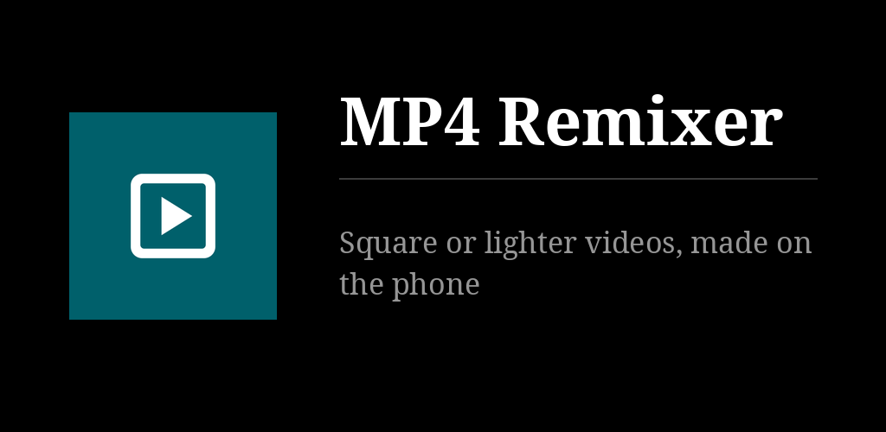

# MP4 Remixer

Pick videos from the gallery, or share them to the app, then make them square, bring them
down to 1080p or 720p, or both. For the square you drag a frame over each video to choose
the part it keeps. The new videos go to `Movies/MP4 Remixer` and the originals are left
alone. No network permission, no ads, no account.

## Key points

- Videos are chosen with the system photo picker or the file browser; the app never asks
  for storage permission. Videos shared from another app are taken too.
- Square (1:1): the frame slides sideways on a landscape video, up and down on a portrait
  one. Each video has its own frame.
- Resolution: 1080p or 720p, counted on the short side. A video already at that resolution
  or below is not enlarged, and a video with nothing to change is not converted at all.
- The picture is re-encoded in H.264 by the phone's own encoder; the sound is copied as it
  is. An HDR recording comes out in standard range.
- Leaving the app or locking the screen does not interrupt a batch. A failed or cancelled
  video leaves nothing behind.
- Each finished video has a **Share** button. Six languages.
- Needs Android 10 or newer.

## Install

[](https://gallaz.ch/eink/#obtainium)

- **F-Droid** (recommended, updates arrive by themselves): add the repository from [gallaz.ch/eink](https://gallaz.ch/eink/#fdroid), or the address `https://funkypitt.github.io/fdroid-repo/repo` in F-Droid.
- **Obtainium**: tap the badge on the phone, or add `https://github.com/funkypitt/mp4-remixer` in Obtainium.
- **APK**: attached to the [latest release](../../releases/latest). No automatic updates.

All three deliver the same file, with the same signature.

## Build

```sh
./gradlew assembleRelease
```

Cropping and scaling are done by [Media3 Transformer](https://developer.android.com/media/media3/transformer)
(Apache-2.0), fetched by Gradle.

## Crédits / Credits

© 2026 Pierre Gallaz. Développé avec [Claude Code](https://claude.com/claude-code) (Anthropic).
Licence GPL-3.0-only, voir `LICENSE`.

© 2026 Pierre Gallaz. Developed with [Claude Code](https://claude.com/claude-code) (Anthropic).
GPL-3.0-only licence, see `LICENSE`.
